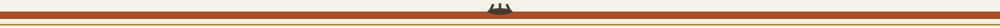
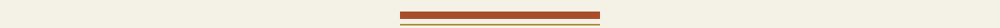

# crypto-cipher

Title block: a field guide entry, common name first and no Latin invented for a programme. The name above is set in Big Shoulders Stencil Display in rust on river white, ruled beneath, with a small harvestman beside this first heading only. The remaining headings keep the entry form without the creature.




## Crypto-Cipher

> Painted board nailed beside the chapter: this tool has no file mode. It reads no files, writes no files, and takes no standard input path; it works only on text handed to it on the command line.



Crypto-Cipher encrypts and decrypts short text strings with Fernet

symmetric encryption, and generates Fernet keys. It works on text given

on the command line only; there is no file input or output mode.

### Installation

> Painted board nailed beside the chapter: a generated key also enters the log. Key generation prints the new key on its own line and also writes that same key into the programme log at information level, so anyone who keeps the log of a generation run keeps a copy of what was generated.


```

pip install -r requirements.txt

```

### Usage

> Painted board nailed beside the chapter: extra arguments beside generation are quietly ignored rather than treated as an error, because the code takes the generation branch before it checks anything else.


```

python3 main.py generate-key

python3 main.py encrypt --key <fernet-key> --text "Hello, world!"

python3 main.py decrypt --key <fernet-key> --text <token-from-encrypt>

```

The key must be a real Fernet key, as produced by `generate-key`; an

arbitrary password string is not accepted. A failed run (bad key, bad

token, or a missing `--key` or `--text`) prints an error and exits 1.

### Verified run note

> Painted board nailed beside the chapter: a bad token can produce an error line whose message is empty, because the underlying library raises it that way. A blank looking error is still a failure and still exits 1.


The commands above are taken from the argument parser in `main.py`. A live run in this environment is blocked because the `cryptography` package is not installed here, so even `--help` stops at that import; no run result is claimed for this tool.

### Security Warnings

* Keep your encryption keys confidential.

* Ensure the security of the communication channel while exchanging keys.

### License

Crypto-Cipher is licensed under the GNU General Public License v3.0. See LICENSE.


## Facts from the code, stated in the prose

This record names: Fernet, generate-key, encrypt, decrypt, --key, --text, positional, exits 0, exits 1, information level, cryptography, 41.0.0, GNU General Public License v3.0, python3 main.py.
